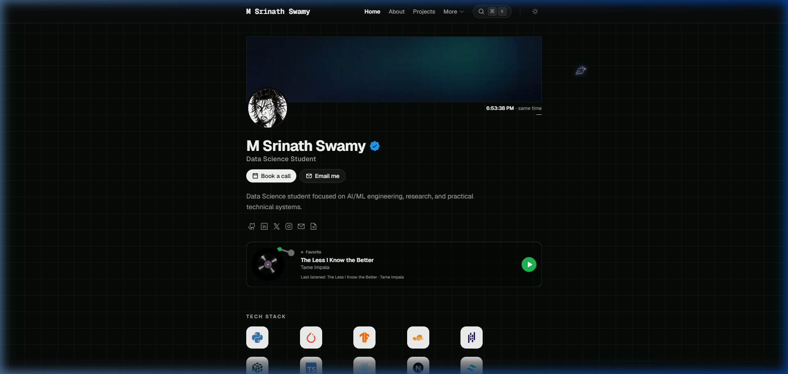

# M Srinath Swamy — Personal Portfolio

[](https://nextjs.org/)
[](https://www.typescriptlang.org/)
[](https://tailwindcss.com/)
[](LICENSE)

Personal portfolio of **M Srinath Swamy** — Data Science student focused on AI/ML engineering, research, and practical technical systems. Built with Next.js 15, TypeScript, Tailwind CSS v4, and MDX.



🌐 **Live Site:** [srinath-portfolio-five.vercel.app](https://srinath-portfolio-five.vercel.app/)  
🐙 **GitHub:** [@srinath9121](https://github.com/srinath9121)  
💼 **LinkedIn:** [srinath-swamy](https://www.linkedin.com/in/srinath-swamy-b41a9b267)  
🐦 **X (Twitter):** [@swamy_srin65891](https://x.com/swamy_srin65891)  
🤗 **Hugging Face:** [@srinath44](https://huggingface.co/spaces/srinath44/solar-ramp-detector)  
✉️ **Email:** [msrinath9700@gmail.com](mailto:msrinath9700@gmail.com)

---

## 🔬 Featured Projects & Research

- **[Solar PV Ramp Detection](https://github.com/srinath9121/solar-pv-ramp-detection)**  
  Multimodal deep learning for early warning of severe solar power ramp events using fisheye sky-camera images and photovoltaic (PV) time series. Built with PyTorch, ResNet-18, LSTM, and deployed as an interactive demo on [Hugging Face Spaces](https://huggingface.co/spaces/srinath44/solar-ramp-detector) utilizing the [SKIPPD Dataset](https://huggingface.co/datasets/srikanthswamym/skippd).

- **[Student Performance Prediction](https://github.com/srinath9121/Analysis-on-Student-grade-Prediction-using-ML)**  
  End-to-end machine learning pipeline analyzing demographic, academic, and social variables to forecast student academic outcomes on the UCI Student Performance benchmark using XGBoost, Random Forest, and Neural Networks.

- **[Airline Passenger Satisfaction Prediction](https://github.com/srinath9121/Analysis-on-Airline-Passenger-Satisfaction-Prediction-using-ML)**  
  End-to-end ML model predicting customer satisfaction based on flight parameters, delay metrics, and service ratings, leveraging SMOTE class balancing and feature importance analysis.

- **Indian Macro Terminal** *(In Development)*  
  An institutional-grade macroeconomic and market intelligence workstation tailored for the Indian financial ecosystem — connecting macroeconomic indicators, RBI policy transmission, global risk, and anomaly detection.

---

## 💼 Experience & Education

- **UNP Education** — *Data Science & Machine Learning Intern* (June–October 2025)  
  Worked on exploratory data analysis, data preprocessing, machine learning model development, and validation.
- **Bhavan's Vivekananda College** — *Bachelor of Science Honours · Data Science*

---

## ✨ Features & Highlights

- **Hero & Profile** — Dynamic bio, technical focus, and social quick links
- **Work & Experience** — Timeline of industry internship experience and key projects
- **Projects Showcase** — Filterable research and engineering projects with live demo and dataset links
- **About** — Educational background, engineering principles, and core competencies
- **Blog & Notes** — Research writeups and technical essays
- **Books & Favourites** — Curated collection of books and media influences
- **Interactive Command Palette** — Seamless navigation across all pages using `⌘K` / `Ctrl+K`
- **Aizen Cursor Companion** — Custom 8-directional animated raven companion
- **Dark / Light Modes** — System-aware fluid theme switcher

---

## 🛠️ Tech Stack

| Layer | Tools |
|---|---|
| **Framework** | [Next.js 15](https://nextjs.org/) (App Router, React Server Components) |
| **Language** | [TypeScript](https://www.typescriptlang.org/) |
| **Styling** | [Tailwind CSS v4](https://tailwindcss.com/) |
| **UI Components** | Radix UI, [cmdk](https://cmdk.paco.me/) |
| **Content** | MDX (`gray-matter`, `next-mdx-remote`) |
| **Icons** | [Phosphor Icons](https://phosphoricons.com/) |
| **Theme** | `next-themes` |

---

## 📁 Repository Structure

```text
├── public/                 # Static assets, logos, and images
├── src/
│   ├── app/                # Next.js App Router (pages and layouts)
│   ├── components/         # Reusable UI components & landing sections
│   ├── config/             # Site configuration, project metadata & experiences
│   │   ├── meta.ts         # SEO and social links
│   │   ├── projects.ts     # Project details, datasets & demos
│   │   ├── experience.ts   # Work & internship history
│   │   ├── education.ts    # Academic background & technical skills
│   │   └── navigation.ts   # Navbar and command palette definitions
│   ├── content/            # MDX articles, blog posts, and project writeups
│   └── lib/                # Utility functions and MDX parsers
```

---

## 🚀 Getting Started

### Prerequisites

- [Node.js](https://nodejs.org/) (v18 or higher recommended)
- `npm` / `pnpm` / `yarn`

### Installation

```bash
git clone https://github.com/srinath9121/Srinath-portfolio.git
cd Srinath-portfolio
npm install
```

### Development

```bash
npm run dev
```

Open [http://localhost:3000](http://localhost:3000) in your browser.

### Build & Production

```bash
npm run build
npm start
```

---

## 📄 License & Attribution

Based on the open-source portfolio template by Priyanshu Urmaliya.  
Licensed under the [MIT License](LICENSE).
